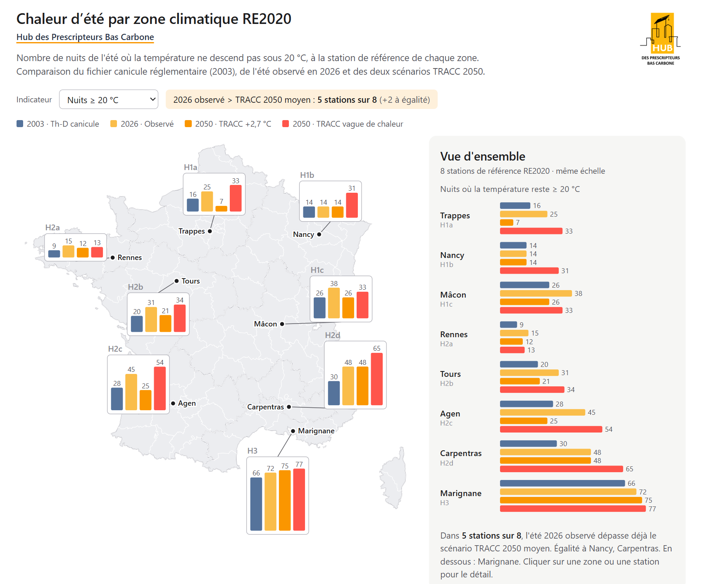

# Carte de comparaison 2003 | 2026 | 2050 de villes en France

Carte interactive des 8 villes de France métropolitaine représentant les 8 zones de la RE2020 avec une comparaison de différents indicateurs dont les nuits chaudes 

**Voir la carte : [https://alliages.github.io/carte_france_2003_2026_2050/](https://alliages.github.io/carte_france_2003_2026_2050/)**

Réalisée avec l'aide du [Hub des Prescripteurs Bas Carbone](https://www.ifpeb.fr/travaux/le-hub-des-prescripteurs-bas-carbone/).

Version actuelle : **1.0.0**

## TODO

rajouter des indicateurs et permettre l'export

## Licence et crédits

GNU GPL v3

Par Guillaume Meunier & Claude
