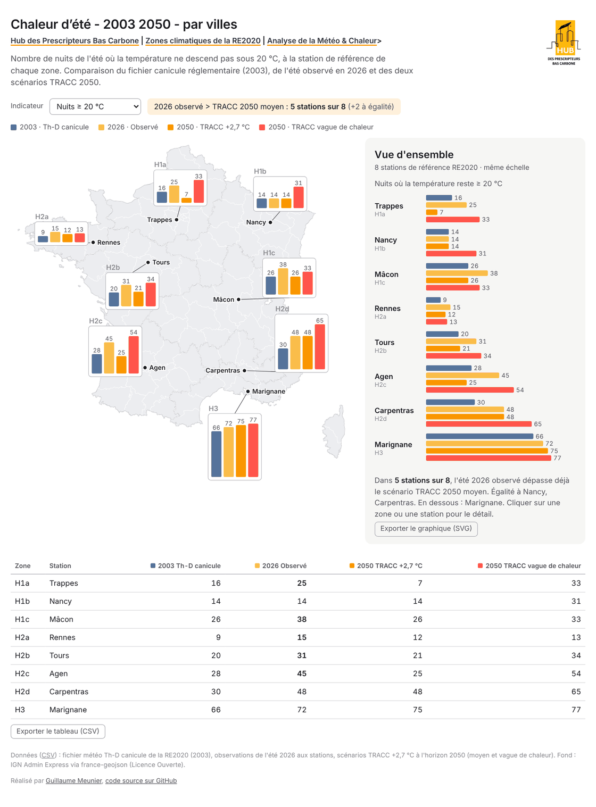
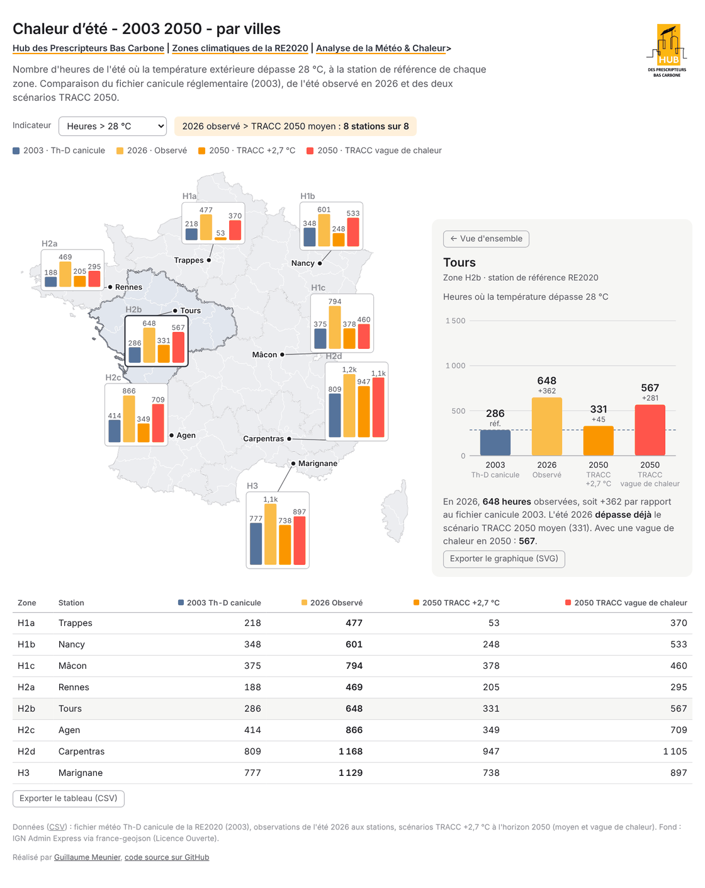

# Carte de comparaison 2003 | 2026 | 2050 de villes en France

Carte interactive des 8 villes de France métropolitaine représentant les 8 zones de la RE2020, avec une comparaison de différents indicateurs de chaleur d'été (nuits chaudes, heures > 28 °C, degrés-heures et, à la demande, six autres) pour trois horizons :

- **2003** : fichier météo Th-D « canicule » de la RE2020 ;
- **2026** : été observé aux stations ;
- **2050** : scénarios TRACC +2,7 °C (moyen, et avec vague de chaleur).

**Voir la carte : [https://alliages.github.io/carte_france_2003_2026_2050/](https://alliages.github.io/carte_france_2003_2026_2050/)**

Réalisée avec l'aide du [Hub des Prescripteurs Bas Carbone](https://www.ifpeb.fr/travaux/le-hub-des-prescripteurs-bas-carbone/).

Version actuelle : **1.1.0**





## Utilisation

- **Indicateur** : le sélecteur en haut change l'indicateur affiché partout (carte, panneau, tableau). Le texte sous le titre définit l'indicateur choisi.
- **Interrupteur « tous »**, discret, à droite du sélecteur : désactivé, le sélecteur ne propose que les 4 indicateurs choisis (DH, heures > 28 °C, nuits ≥ 20 °C, nuits ≥ 24 °C) ; activé, il ajoute les autres indicateurs actifs (DH nuit, nuits tropicales consécutives, températures moyennes, vagues de chaleur). En le désactivant alors qu'un autre indicateur est affiché, la carte revient aux nuits ≥ 20 °C.
- **Carte** : chaque station porte un mini-histogramme de 4 barres (2003, 2026, 2050, 2050 vague de chaleur), à la même échelle pour toutes les stations.
- **Sélection** : un clic sur une zone, un glyphe ou une ligne du tableau ouvre le détail de la station dans le panneau (valeurs et écarts à 2003). `Échap` ou « Vue d'ensemble » revient à la comparaison des 8 stations.
- **Compteur** : nombre de stations où l'été 2026 observé dépasse déjà le scénario TRACC 2050 moyen.
- **Exports** :
  - « Exporter le tableau (CSV) », sous le tableau : l'indicateur affiché, séparateur `;`, virgule décimale, ouvrable directement dans Excel en français ;
  - « Exporter le graphique (SVG) », dans le panneau : le graphique affiché (détail de la station ou vue d'ensemble), en SVG autonome, thème clair, fond blanc ;
  - le CSV complet des données (tous les indicateurs) reste téléchargeable en pied de page.

La page fonctionne aussi en ouvrant `index.html` directement dans un navigateur : pas de serveur, pas de dépendance, pas de compilation.

## Structure du dépôt

| Fichier | Rôle |
| --- | --- |
| `index.html` | structure de la page |
| `styles.css` | styles (thèmes clair / sombre) |
| `js/config.js` | réglages : indicateurs choisis, interrupteur « tous », indicateur de départ, gabarits de dessin, style de l'export SVG |
| `js/utils.js` | formats de nombres, échappement HTML, création d'éléments SVG, téléchargement de fichiers |
| `js/script.js` | dessin de la carte, du panneau et du tableau, interactions, exports |
| `js/zones.js`, `js/departements.js` | contours des 8 zones et des départements |
| `js/data.js` | **généré** — ne pas modifier à la main |
| `data/` | sources : `comparaison_meteo.csv`, `stations.json` (positions), `situations.json`, `indicateurs.csv` (libellés), `hypotheses.csv` (seuils) |
| `build/build_data.py` | régénère `js/data.js` à partir de `data/` |
| `docs/` | captures d'écran |
| `img/` | logo et icônes |

## Description du code

### Chaîne de données

```
data/comparaison_meteo.csv ─┐
data/stations.json         ─┤
data/situations.json       ─┼─ build/build_data.py ─▶ js/data.js ─▶ page
data/indicateurs.csv       ─┤
data/hypotheses.csv        ─┘
```

- `comparaison_meteo.csv` : une ligne par station et par situation, une colonne par indicateur (`dh`, `heures_chaudes`, `nuits_20`, `nuits_24`, `t_moyenne`, etc.).
- `stations.json` : pour chaque zone, la station de référence, sa position sur la carte (`x`, `y`) et celle de son glyphe (`gx`, `gy`), en pixels du `viewBox` du SVG.
- `situations.json` : les 4 situations comparées (clé, année, libellé, couleur), dans l'ordre d'affichage.
- `indicateurs.csv` (séparateur `;`) : pour chaque indicateur, libellé, unité, ordre, `actif` (0 = jamais proposé), bulle (définition affichée sous le titre et au survol du sélecteur) et nombre de décimales. Les libellés et bulles citent des repères `[[hyp:…]]`.
- `hypotheses.csv` (séparateur `;`) : valeurs de ces repères (seuils 20 / 24 / 28 °C, nuit 22h-6h, centiles des vagues de chaleur…).
- `indicateurs.csv` et `hypotheses.csv` sont repris de `config/` du dépôt [vulgarisateur_DH](https://github.com/Alliages/vulgarisateur_DH) (Météo & Chaleur), qui a calculé les indicateurs : les recopier tels quels quand ils changent là-bas.
- `build_data.py` fusionne ces sources et écrit `js/data.js`, qui définit trois constantes globales : `SITUATIONS`, `STATIONS` (chaque station contient `valeurs[situation][indicateur]`) et `INDICATEURS_LISTE` (triée par ordre, repères remplacés par leur valeur). Le script s'arrête avec un message clair si une ligne du CSV ou un repère manque.

### Page web

Les scripts sont des scripts classiques chargés dans l'ordre de `index.html` (`config.js`, `utils.js`, `zones.js`, `departements.js`, `data.js`, `script.js`). Ils partagent des constantes globales, ce qui permet d'ouvrir la page en local sans serveur.

- **`config.js`** : `INDICATEURS_CHOISIS` (liste courte), `TOUS_PAR_DEFAUT` (état de l'interrupteur à l'ouverture), `INDICATEUR_DEPART`, station de départ, situation de référence (`REFERENCE`), gabarits de dessin (`BARRE_*`, `G`, `E`) et style embarqué dans les SVG exportés.
- **`utils.js`** : `fmt` / `fmtEcart` / `fmtCourt` / `fmtAxe` (formats français, nombre de décimales de l'indicateur), `pasRond` (graduations), `esc` (protège le HTML venant des données), `el` (crée un élément SVG), `activer` (clic + clavier), `telecharger` et `slug` (exports).
- **`script.js`** : tout le dessin est refait à chaque changement d'indicateur par `toutDessiner()`.
  - `INDICATEURS` : indicateurs proposés (actifs de `INDICATEURS_LISTE`) ; `remplirSelecteur()` construit la liste courte ou complète selon l'interrupteur « tous » ;
  - `dessinerEntete()` : sous-titre et compteur 2026 > TRACC 2050 moyen ;
  - `dessinerGlyphes()` : mini-histogrammes sur la carte, avec trait de rappel vers la station ;
  - `dessinerTableau()` : tableau récapitulatif ;
  - `dessinerGraphe(station)` et `dessinerEnsemble()` : les deux vues du panneau ;
  - `choisir(zone)` : sélection d'une zone (`null` = vue d'ensemble), synchronise carte, tableau et panneau ;
  - `exporterTableau()` et `exporterGraphe()` : exports CSV et SVG, générés dans le navigateur.
- **`maxNational`** : maximum de l'indicateur actif, toutes stations et situations confondues, qui fixe l'échelle commune à la carte et aux graphiques.

Les graphiques sont du SVG pur, dessiné à la main, sans bibliothèque. Les couleurs et le thème sombre passent par des variables CSS (`styles.css`).

## Mettre à jour les données

Modifier `data/comparaison_meteo.csv` (une ligne par station et par situation), puis, depuis la racine :

```
python3 build/build_data.py
```

Pour ajouter un indicateur : ajouter la colonne à `comparaison_meteo.csv` et sa ligne à `indicateurs.csv` (`actif` = 1), puis relancer le script. Il apparaît dans la liste complète (interrupteur « tous ») ; pour l'avoir dans la liste courte, ajouter son identifiant à `INDICATEURS_CHOISIS` (`js/config.js`). Le sélecteur, le tableau et les exports le prennent en compte automatiquement.

Pour ajouter une situation (ou en changer la couleur) : modifier `data/situations.json` et ajouter les lignes correspondantes au CSV.

## Sources des données

- 2003 : fichier météo Th-D canicule de la RE2020 ;
- 2026 : observations de l'été 2026 aux stations ;
- 2050 : scénarios TRACC +2,7 °C (moyen et vague de chaleur) ;
- définitions et seuils des indicateurs : outil [Météo & Chaleur](https://vulgarisateurdh.streamlit.app/) ([vulgarisateur_DH](https://github.com/Alliages/vulgarisateur_DH)) ;
- fond de carte : IGN Admin Express via france-geojson (Licence Ouverte).

## Versions

- **1.1.0** : interrupteur « tous » pour afficher tous les indicateurs actifs ; libellés, définitions et décimales lus dans `data/indicateurs.csv` et `data/hypotheses.csv` ; numéro de version en pied de page.
- **1.0.0** : première version (4 indicateurs, carte, panneau, tableau, exports CSV et SVG).

## TODO

Rien pour le moment.

## Licence et crédits

GNU GPL v3

Par Guillaume Meunier & Claude
